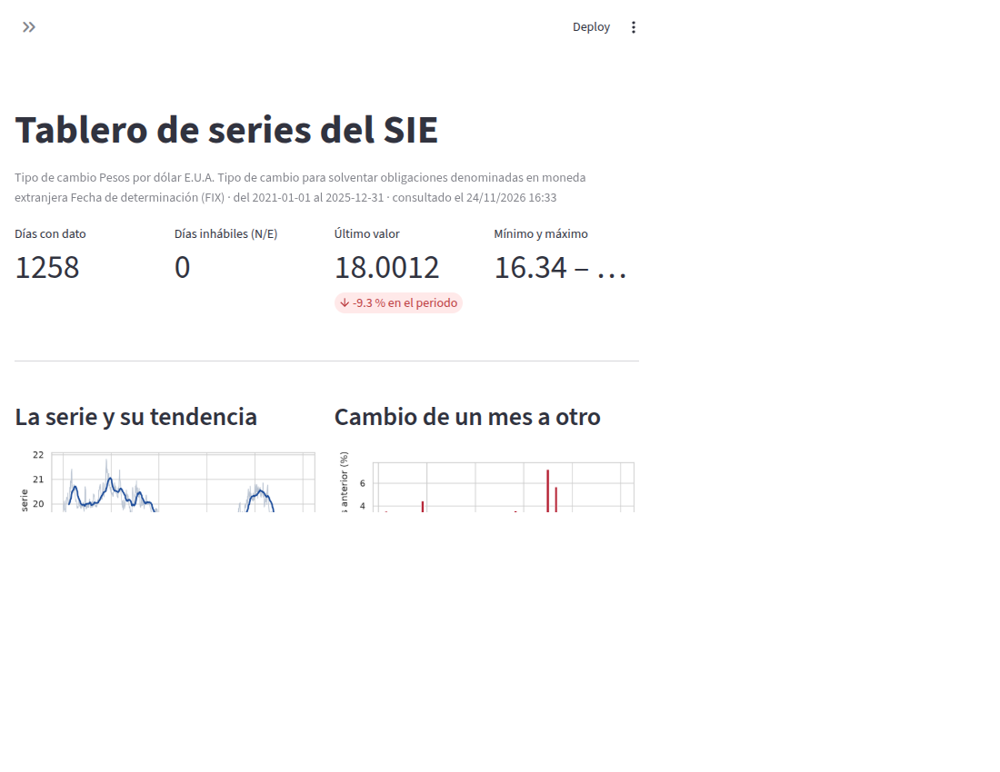
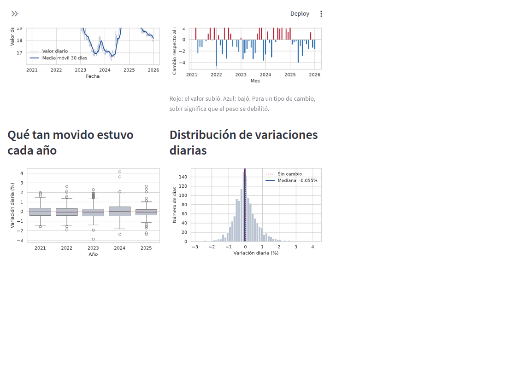

# Tablero de series de Banxico

Dashboard en Streamlit para consultar series del Sistema de Información
Económica (SIE) de Banco de México. El valor inicial es `SF43718` (tipo de
cambio FIX); también se pueden introducir varias claves del catálogo.

## Preparación

1. Instala las dependencias con `pip install -r requirements.txt`.
2. Solicita un token gratuito en
	<https://www.banxico.org.mx/SieAPIRest/service/v1/token>.
3. En `.streamlit/secrets.toml`, reemplaza el marcador por tu token:

	```toml
	banxico_token = "TU_TOKEN_DEL_SIE"
	```

El archivo de secretos es local y está excluido de Git. No publiques tu token.

## Ejecución

```bash
streamlit run dashboard_banxico.py
```

En la barra lateral se configuran las claves y el periodo. El tablero presenta
la tendencia, el cambio mensual, la variación diaria por año y la distribución
de las variaciones diarias. Los datos se pueden consultar y descargar como CSV.

## Evidencia de funcionamiento

Las capturas se tomaron con la serie `SF43718` y datos consultados al SIE de
Banxico:





## Estructura

```text
HerramientasVisualizacion/
├── .streamlit/
│   └── secrets.toml
├── dashboard_banxico.py
├── evidencia/
│   ├── dashboard_banxico.png
│   └── graficas_banxico.png
├── README.md
└── requirements.txt
```
